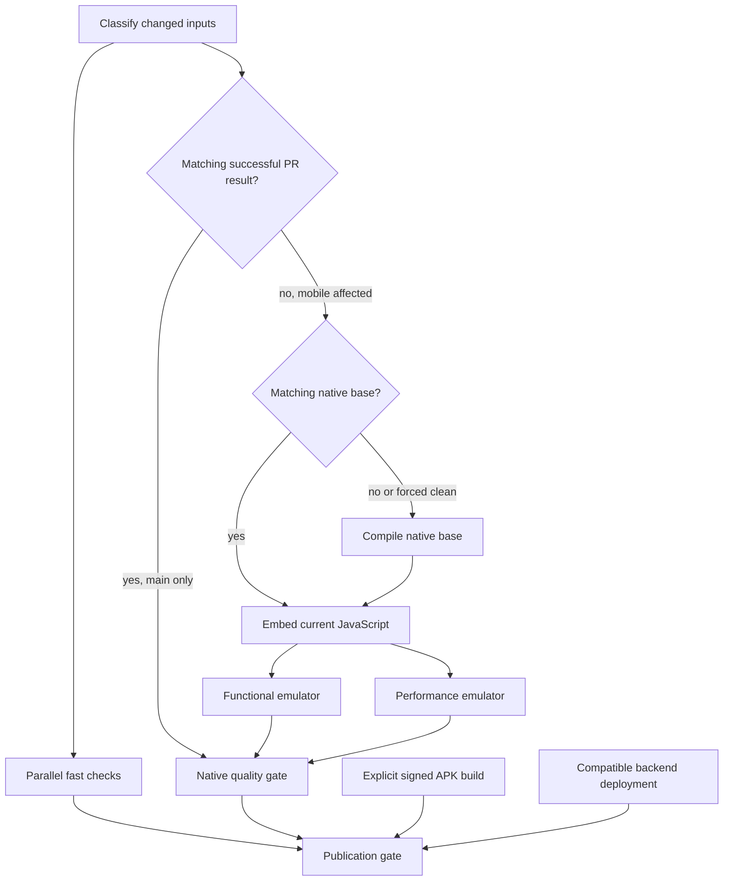

# Mobile CI reuse and publication

GitHub Actions remains the CI controller. Bun remains the package manager.
The existing fast checks stay parallel and run on PRs and main pushes.
CI fixture APKs and signed production APKs remain separate.

## Execution paths

Known independent web UI, CLI and documentation changes skip native jobs.
Mobile code, shared backend code, root dependency changes, native patches,
CI harness changes and unknown paths take the mobile validation path.
Mobile test-only changes retain their fast tests without compiling Android.
New shared code should be added to the classifier rather than assumed independent.

## Reusing native code

`context.ts` records the complete Git tree, harness input hash, runner image
and whether a clean run is required. `fingerprint.ts` combines Expo's Android
fingerprint with the fixed toolchain and the native build recipe. SDK,
native dependency, plugin, patch or recipe changes invalidate the base.

The native cache contains only the `com.pravah.mobile.e2e` APK, its test-only
Android debug keystore and their checksums. Production signing credentials
never enter this cache. Invalid or missing cache data takes the native build
path. PR caches can speed up later pushes to the same PR.

Every mobile run then uses pinned `@expo/repack-app` to embed its current JS
bundle and assets. Repack is used for CI, not production delivery. A source-tree
marker in the fixture bundle must match the current checkout. APK verification
also checks package, runtime, architecture, signature and disabled OTA updates.
The initial native build uses a zero marker, so even a cold run proves that
Repack replaced the embedded bundle before tests begin.

The prepared APK is uploaded once for both device jobs. APK artifacts expire
after one day; result metadata and device evidence remain for 14 days.
If a required artifact has expired, main performs validation again.

## Independent device jobs

The functional job retains capture, keyboard-visible save, title edit,
completion, Timeline, Goals detail, Progress history, Appearance navigation
and Kairo tool validation. The performance job retains five cold process
launches, the Maestro large-Inbox assertion, controlled ADB swipes, raw frame
statistics and process memory.

Each job uses its own runner, emulator, fresh app data and loopback fixture
server. No Metro or production service is needed during the device tests.
They use API 35, the same Pixel 6 logical layout, emulator build 16428233,
Maestro 2.11.0 and the existing startup/frame budgets. Host scheduling and
renderer noise still prevent these numbers from establishing a phone speedup.

`Android native workflows and performance` remains the stable aggregate
check name. It fails if preparation, either device suite, the persistence
benchmark or an applicable release-contract check fails. A skipped mobile
path is reported explicitly; it is not recorded as completed device coverage.

## Reusing validation after merge

Main considers only the latest native run for its associated merged PR.
The producer must be an internal PR in this repository and that latest run
must have completed successfully. Fork results and older passing attempts
behind a newer failure are not reused.

The stored complete Git tree, native fingerprint, harness hash, runner image,
repository and successful suite results must match. The APK artifact must
still exist. An exact match reuses the validation and verifies the APK again
before promoting it into main's native-base cache. API errors, mismatches or
expired artifacts cause a fresh run.

This artifact promotion is needed because GitHub scopes PR caches to their
merge refs. Main cannot directly restore a PR's cache. Fork-originated
artifacts are never promoted into main's cache.

## Releases

Normal compatible JS releases still use OTA. Native changes still use the
signed EAS APK build. The existing version/runtime stamping and canonical
Convex deployment checks remain in place.

APK building or OTA staging, backend preparation and source validation run
as independent jobs. Publication waits for all of them. Source validation
requires an exact commit already on main and successful GitHub Actions
checks for lint, both type checks, both test suites, web/CLI builds and both
stable mobile checks. Missing checks wait; failed or cancelled checks block
publication. This gate does not rebuild the APK.

Before staging a signed APK, CI checks its source SHA, package, version name,
version code, runtime, ARM64 support, canonical backend URL and absence of
the fixture transport. The signer must match the public certificate digest
recorded from the existing release lineage in `android-signer.sha256`.
A signing-key rotation requires an explicit update to that digest.
The release-contract job exercises this verifier against published 3.0.34
without launching it or contacting production services from the app.

Old source commits that predate the required checks cannot use the new
publication gate without validation. Existing rollback workflows remain
separate and unchanged. No release is triggered by this CI-only change.

## Clean builds and measurements

The daily scheduled run forces the native compilation path with Gradle's
build cache disabled and tasks rerun. Manual dispatch supports `force_clean`.
Neither schedules nor manual runs reuse prior validation results.
PR runs cancel obsolete PR work; main and scheduled runs do not cancel one
another's candidate validation.

Job summaries report whether validation was skipped, reused, repacked or
compiled. Device artifacts retain absolute startup/frame measurements and
the unmet 100 ms target alongside the existing 20% regression allowance.
CI duration comparisons must distinguish cold builds, warm repacks and
merge-result reuse. No time saving is claimed before observing those paths.

References: [Expo Repack](https://docs.expo.dev/build-reference/repack/),
[GitHub cache scope](https://docs.github.com/en/actions/reference/workflows-and-actions/dependency-caching#restrictions-for-accessing-a-cache).
